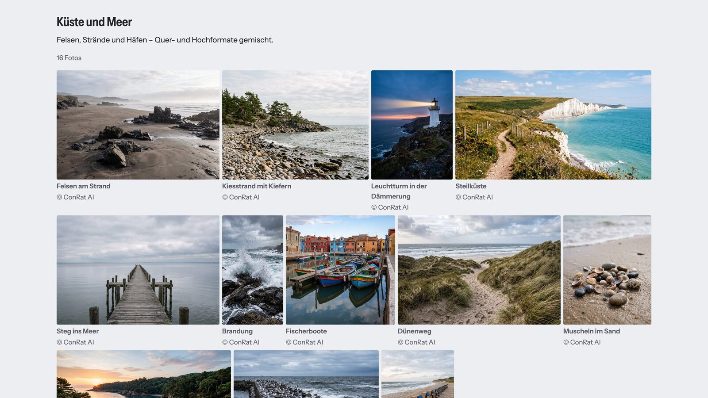
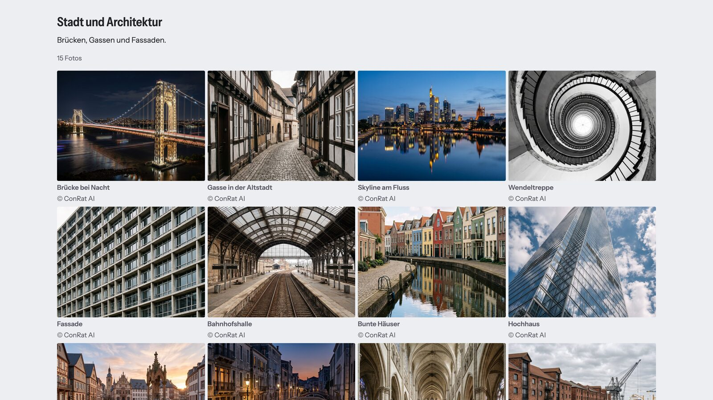
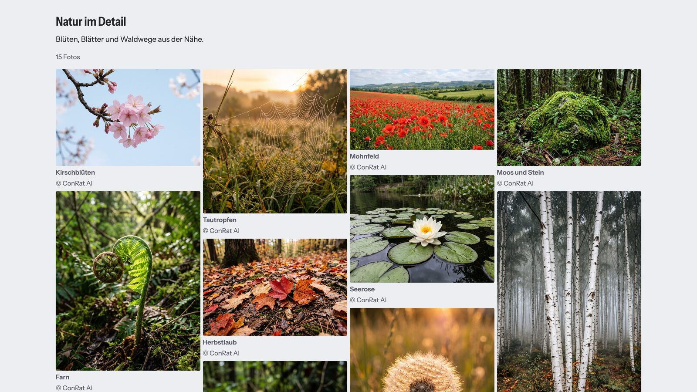
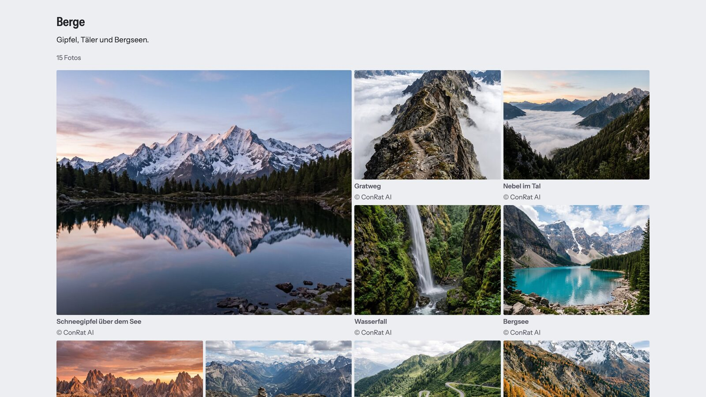
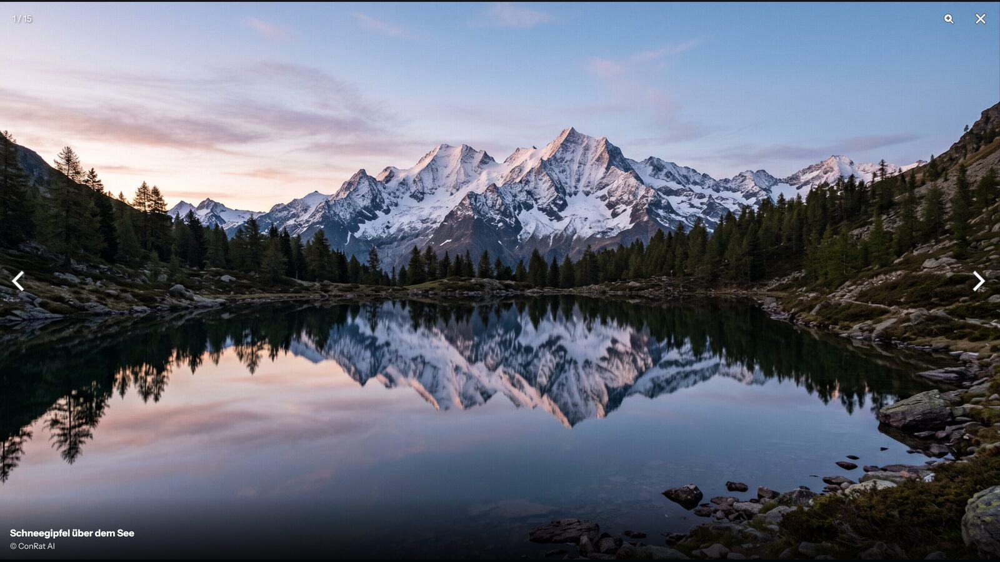
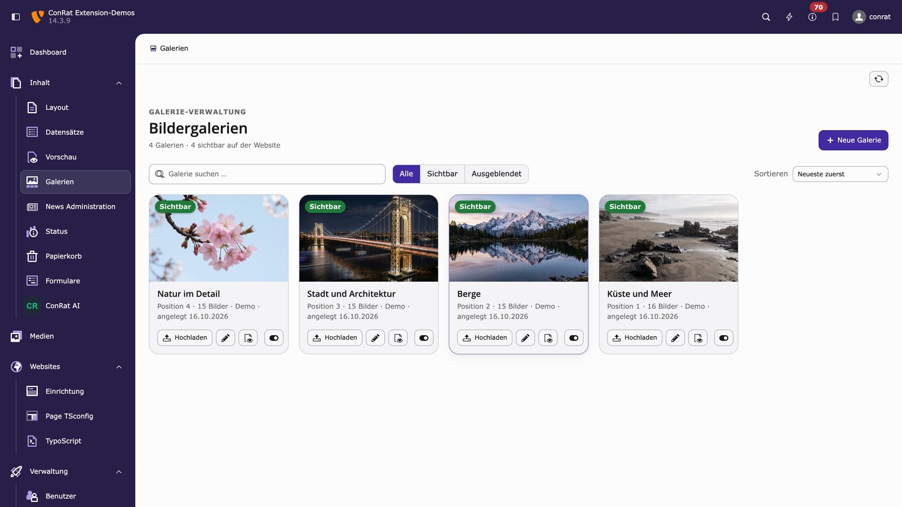

# ConRat Photo Gallery for TYPO3 14 (crgalerie)

*Deutsche Fassung: [README.de.md](README.de.md)*

Image galleries maintained centrally in a backend module (“Content > Galleries”): create galleries, upload images by
drag and drop, sort them, hide images and galleries. Galleries are not tied to pages – editors maintain them in one
place and content elements display them anywhere.

- Upload via the FAL API: format check by file content, EXIF/GPS removed, images reduced to a maximum size,
  HEIC converted to JPG
- Responsive frontend: `srcset`/`sizes`, lazy loading, four layouts (justified rows, grid, masonry columns,
  large cover image), “Show all X photos”
- Accessible lightbox (PhotoSwipe 5): swipe, arrow keys, ESC, caption and credits, counter, focus handling
- No jQuery, works with TYPO3’s Content Security Policy, English and German included

**Live demo:** https://demotypo14.conrat-projects.de/fotogalerie ·
**Documentation:** [Documentation/](Documentation/Index.rst) (published on docs.typo3.org after the TER release) ·
**Product page:** https://somesolutions.de/typo3-bildergalerie/

| Mosaic in rows | Grid |
|---|---|
|  |  |
| **Mosaic in columns** | **Large cover image and grid** |
|  |  |
| **Lightbox** | **Backend module** |
|  |  |

## Requirements

- TYPO3 14.3, PHP 8.2–8.5
- ImageMagick or GraphicsMagick enabled in the Install Tool (HEIC upload needs a build with HEIC support)

## Installation

```bash
composer require conratwebsolutions/crgalerie
vendor/bin/typo3 extension:setup
```

## Configuration

1. **Extension configuration** (Settings > Extension Configuration > crgalerie):
   - `storagePid` – folder in which the module stores new galleries and images. Older galleries are often on the
     root level (pid 0); only admins can edit those – move them into the folder for editors.
   - `previewPid` – page with a “Gallery overview” element, used for the preview links in the module
   - `uploadFolder` – FAL folder for uploaded images (default `1:/galerien/`); one subfolder
     `<uid>-<slug of the title>` is created per gallery (e.g. `12-summer-party-2026`)
   - `maxBildgroesse` – longest side in pixels to which images are reduced on upload (default 2560)
2. **Site set** “ConRat Photo Gallery” (`conrat/crgalerie`): add it as a dependency in the site configuration.
3. **Site settings** (optional):
   - `crgalerie.pageTitle` – page title when a gallery is shown, e.g. `{galerie} – Photo gallery`
   - `crgalerie.metadata.creditField` – author column in `sys_file_metadata`, e.g. `creator`
   - `crgalerie.metadata.licenseField` – license column, e.g. `copyright`
   - `crgalerie.frontend.css` – set to `false` to use your own CSS (the lightbox CSS is always loaded)

### Limitations

- **One gallery collection per installation:** galleries and categories are not tied to pages and `storagePid` is
  global. In installations with several sites, module and content elements show the galleries of all sites; they
  can only be separated by categories.
- **Translation:** galleries and images are not translated; image titles and captions come from the file metadata
  (`sys_file_metadata`) or the image record in the default language.
- **Workspaces:** the module always shows the live state.

## Content elements

- **Gallery** – shows one selected gallery.
- **Gallery overview** – tiles of all galleries (or of one category); a click opens the gallery on the same page.

## Frontend

- **Layout** (per element): justified rows (default), grid, masonry columns, large cover image with grid.
- **Images shown at first**: default 12, 0 = all; further images appear via “Show all X photos”. They are delivered
  with `hidden` (so the browser does not preload them). Without JavaScript, a `<noscript>` stylesheet shows all images.
- **Overview tiles**: title below the image (default) or on the image.
- Lightbox with PhotoSwipe 5 (swipe, arrow keys, ESC, zoom) showing title, caption and credits. It is a named, modal
  dialog (“Image viewer: <gallery title>”, `aria-modal="true"`); focus moves into the dialog on opening – also by
  mouse or touch – and back to the opened image on closing.
- The lightbox sits above cookie banners and other overlays (`z-index` 2147483000, see `--crg-lightbox-z`).
- Lists and links of gallery and overview are protected against typical project rules (bullets, indentation,
  underlined links, `* { margin: 0 auto }`), see “Robust against project CSS”.

### Customising the look

The bundled CSS only reads CSS variables with a default (`var(--crg-…, default)`) and never sets them. Your values
therefore always win – on `:root` for the whole page or on `.crg` (gallery) or `.crg-uebersicht` (overview),
regardless of whether the project CSS is loaded before or after the crgalerie CSS:

```css
:root {
    --crg-abstand: 12px;            /* gap between images, default 8px */
    --crg-radius: 0;                /* corner radius, default 4px */
    --crg-akzent: #b0002a;          /* button and focus outline, default currentColor */
    --crg-text-gedaempft: #555;     /* secondary texts, default #666 */
    --crg-zeilenhoehe: 260px;       /* justified rows from 600 px, default 220px */
    --crg-zeilenhoehe-mobil: 120px; /* below 600 px, default 100px */
}
.crg {
    --crg-spalten: 5;               /* from 1024 px, default 4 (overview 3) */
    --crg-spalten-tablet: 3;        /* 600–1023 px, default 3 (overview 2) */
    --crg-spalten-mobil: 1;         /* below 600 px, default 2 (overview 1) */
}
.pswp { --crg-lightbox-hintergrund: #111; }
:root { --crg-lightbox-z: 10000; }  /* lightbox layer, default 2147483000 */
```

The column count applies to grid, cover image and masonry columns (gallery) and to the overview tiles. Breakpoints
have their own variables, so `--crg-spalten` only affects desktop widths.

The `sizes` values of the thumbnails are tuned to the defaults (DPR 2 phones get sharp images, DPR 3 phones aim at
double instead of triple density):

- Justified rows: per image from aspect ratio r and row height, via the ViewHelper `crg:zeilenSizes`:
  `(min-width: 600px) min(100vw, r × 308 px), (min-resolution: 2.5dppx) min(100vw, r × 88 px), min(100vw, r × 133 px)`
  (row height × reserve for stretching: 220 px × 1.4 from 600 px, 100 px × 1.33 or × 0.88 from DPR 2.5 below).
- Grid/columns: `(min-width: 1024px) min(25vw, 360px), (min-width: 600px) 33vw, 34vw`.
- Cover image (first image): `(min-width: 1024px) min(50vw, 720px), 67vw`.
- Overview: `(min-width: 1024px) 33vw, (min-width: 600px) 50vw, 100vw` with variants 400/800.

If you change row heights or columns, adapt `sizes` in your own `Partials/Galerie/Bilder.html`, otherwise images
become blurry or unnecessarily large: with `--crg-spalten-mobil: 1`, `34vw` is far too small (image ≈ 100vw); for
other row heights pass them to the ViewHelper, e.g.
`{crg:zeilenSizes(verhaeltnis: quellen.verhaeltnis, zeilenhoehe: 260, zeilenhoeheMobil: 120)}` (pixel values only).

Own CSS instead of the bundled one: site setting `crgalerie.frontend.css: false`. Your CSS must then contain at least
`.crg__bild[hidden] { display: none; }` (otherwise the images behind “Show all X photos” are visible at once).

### Robust against project CSS

Global rules from site packages such as `.frame-default ul li { list-style: disc; padding: 4px 0 }`,
`a, a span { text-decoration: underline }` or `* { margin: 0 auto }` do not affect gallery and overview: lists, list
items (including `::before`/`::marker`), tile links, image links, the “Show all” button and the back link are reset
with a doubled class (specificity 0,2,x, without `!important`). To change these properties deliberately, use at least
two classes as well, e.g. `.crg-uebersicht .crg-uebersicht__kachel { color: … }`.

### Pre-generating image variants

TYPO3 renders three thumbnail sizes (400/800/1200 px) and one lightbox variant (longest side 2560 px) per image.
Uploads in the module do this immediately. For existing images (e.g. after a migration or after clearing
`_processed_`), run once so that the first page view does not have to render all variants at once:

```bash
vendor/bin/typo3 crgalerie:vorwaermen             # all visible images
vendor/bin/typo3 crgalerie:vorwaermen --galerie=7 # one gallery only
```

## Texts and translations

All texts live in `Resources/Private/Language/` – English as source language (`locallang*.xlf`), German in
`de.locallang*.xlf`. The frontend follows the site language (`locale`), the backend module follows the editor’s
language. For further languages add a `<language>.locallang.xlf` with the same keys.

Change single frontend texts with TypoScript:

```typoscript
plugin.tx_crgalerie._LOCAL_LANG.en {
    frontend.showAll = View all %d pictures
}
```

Or override whole files (frontend and backend), e.g. in the `ext_localconf.php` of your site package:

```php
$GLOBALS['TYPO3_CONF_VARS']['LANG']['resourceOverrides']['EXT:crgalerie/Resources/Private/Language/locallang.xlf'][]
    = 'EXT:my_sitepackage/Resources/Private/Language/Overrides/crgalerie.xlf';
```

## Permissions for editors

The module writes via the DataHandler and the FAL API. Checklist for the editor group (verified by the functional
tests with the fixture `Tests/Functional/Fixtures/ModulRedakteurMitRechten.csv`):

- [ ] Module access “Content > Galleries” (`web_crgalerie`)
- [ ] Tables (listing and modify): gallery (`tx_crgalerie_domain_model_galerie`), gallery image
      (`tx_crgalerie_domain_model_bilder`), file reference (`sys_file_reference`), file (`sys_file`),
      file metadata (`sys_file_metadata`)
- [ ] Allowed excludefields: “Hidden” (`hidden`) of gallery and gallery image
- [ ] DB mount on the gallery folder (`storagePid`) with “Edit content” permission
- [ ] File mount on the upload folder (`uploadFolder`, e.g. `1:/galerien/`) with the file permissions read folder,
      add folder, read file, add file, write file, delete file
- [ ] Image processing (ImageMagick/GraphicsMagick) enabled in the Install Tool

Galleries on the root level (pid 0) can only be edited by admins.

## Overriding templates

```typoscript
plugin.tx_crgalerie.view {
    templateRootPaths.20 = EXT:my_sitepackage/Resources/Private/Crgalerie/Templates/
    partialRootPaths.20 = EXT:my_sitepackage/Resources/Private/Crgalerie/Partials/
}
```

The template for a gallery is `Partials/Galerie/Bilder.html`, for the overview `Templates/Uebersicht/List.html`.

Variables: `galerie` (gallery object), `bilder` (list with `datei`, `titel`, `beschreibung`, `credit`),
`showDescription` (0–3), `darstellung`, `anzahlStart`, `sizes`, `sizesTitel`, `cssEinbinden`, `elementUid`,
`titelEbene` (2–6); in the overview `galerien` (with `titel`, `erstesBild`, `anzahlBilder`) and `kachelstil`.

The ViewHelper `<crg:bildQuellen datei="{…}" as="quellen">` (namespace `Conrat\Crgalerie\ViewHelpers`) provides
`src`, `srcset`, `breite`, `hoehe`, `grossUrl`, `grossBreite`, `grossHoehe`, `verhaeltnis`. Arguments: `breiten`
(thumbnail widths, default `{0: 400, 1: 800, 2: 1200}`; `src` is the middle one) and `gross` (longest side of the
lightbox variant, default 2560; `0` = no own variant, `grossUrl` is then `src`).

### Markup contract for own gallery templates

`galerie.js` (lightbox and “Show all”) and the CSS rely on these hooks – keep them when overriding `Bilder.html`:

- `<f:render partial="Galerie/Assets" arguments="{cssEinbinden: cssEinbinden}" />` – includes CSS, PhotoSwipe and
  `galerie.js` (`lightbox: 0` omits lightbox CSS and script, as in the overview).
- `data-crg-galerie` on the container of a gallery (one lightbox per container).
- `data-crg-text-dialog`, `-close`, `-zoom`, `-previous`, `-next`, `-error` on the container: translated lightbox
  texts (if missing, `galerie.js` uses English texts).
- `.crg__liste` with `data-crg-anzahl-start="{anzahlStart}"`, containing one `.crg__bild` per image.
- `.crg__titel` in the container: its text names the lightbox dialog.
- `a.crg__link` with `href="{quellen.grossUrl}"`, `data-pswp-width` and `data-pswp-height` (size of the large
  variant); `data-cropped="true"` if the thumbnail is cropped (grid, rows, cover image).
- `[data-crg-lightboxtext]` (with `hidden`) in the same `.crg__figur` – shown as caption in the lightbox.
- `[data-crg-mehr]` (with `hidden`) as the “Show all X photos” button.
- Images after `anzahlStart` delivered with `hidden`, plus the `<noscript>` stylesheet from `Bilder.html`
  (`galerie-noscript.css`). Do not use a `<style>` element: TYPO3’s Content Security Policy blocks it.

In the “masonry columns” layout images flow column by column; lightbox, keyboard and screen readers follow the HTML
order, which differs from the visual arrangement.

## Development

Install dependencies and run the checks (requires ImageMagick or GraphicsMagick):

```bash
composer install
.Build/bin/phpstan analyse -c Build/phpstan.neon
typo3DatabaseDriver=pdo_sqlite .Build/bin/phpunit -c Build/phpunit/FunctionalTests.xml
```

## Support and contributing

Bug reports and feature requests: [GitHub issues](https://github.com/ConRatWebSolutions/conrat-typo3-photo-gallery/issues).
Security issues: please do not open a public issue, see [SECURITY.md](SECURITY.md).
Contributions are welcome, see [CONTRIBUTING.md](CONTRIBUTING.md).

## License

GPL-2.0-or-later, see [LICENSE](LICENSE). Bundles [PhotoSwipe](https://photoswipe.com) 5.4.4 (MIT license, see
`Resources/Public/Vendor/photoswipe/LICENSE`).

Developed by ConRat WebSolutions GmbH – product page: [somesolutions.de/typo3-bildergalerie](https://somesolutions.de/typo3-bildergalerie/).
